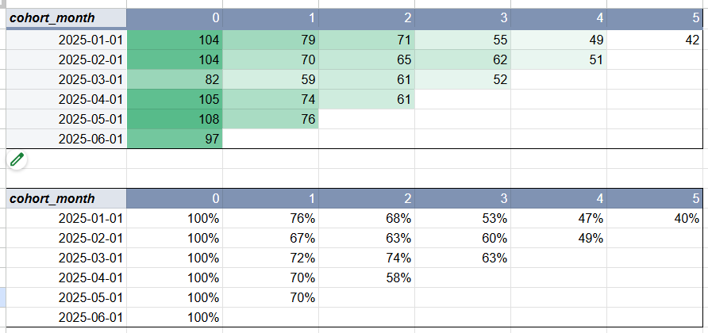

# Cohort Retention Analysis: Promo vs Organic Users

Final project of the SQL block in the GoIT Data Analyst program.

**Interactive cohort tables (Google Sheets):** [open the dashboard](https://docs.google.com/spreadsheets/d/1WFRwWqydTIHnizN0yCUnaRquwVv_OwvUmOvDOz61yWs/edit?gid=0#gid=0)

## Idea

A product attracts users in two ways: through promo campaigns and organically.
The goal was to find out which channel brings users who stay with the product longer.

## Data

Two raw tables:
- `cohort_users_raw`: user ID, signup date, promo signup flag
- `cohort_events_raw`: user events with date, type and revenue

Dates came in different formats (`.`, `/`, `-` separators, 2- or 4-digit years, extra spaces and time parts), so they had to be cleaned before any analysis.

## Tools

- **SQL (PostgreSQL)**: data cleaning, joins, cohort calculation
- **Google Sheets**: pivot tables, Retention Rate, conditional formatting, slicers

## What I did

1. **Cleaned the dates in SQL.** Trimmed spaces, cut off the time part, unified separators, checked each part with regular expressions, padded day and month, expanded 2-digit years and converted the result to `TIMESTAMP`.
2. **Joined users and events** step by step with CTEs. Removed rows with invalid dates, empty event types, test events and events that happened before signup.
3. **Built cohorts.** Cohort = signup month, activity = event month, `month_offset` = number of months between them. Limited activity to January–June 2025.
4. **Counted active users** per cohort and month offset, split by promo and organic users.
5. **Built cohort tables in Google Sheets** with absolute numbers and Retention Rate, a heatmap and a slicer to switch between promo and organic users.

The full query is in [`cohort_analysis.sql`](cohort_analysis.sql).

## Results

Analyzed 600 users from 6 monthly cohorts (January–June 2025).

| Month after signup | Promo users | Organic users |
|---|---|---|
| 1 | ~55% | ~81% |
| 2 | ~41% | ~80% |
| 3 | ~25% | ~77% |
| 5 | ~9% | ~56% |

*Average Retention Rate across cohorts.*

## Conclusion

Users who came organically stay with the product much longer than users who came through promo campaigns.
Promo brings many new users at once, but they leave quickly.
For long-term retention, organic acquisition works better than promo campaigns, so promo campaigns should be evaluated by retention, not only by the number of sign-ups.
